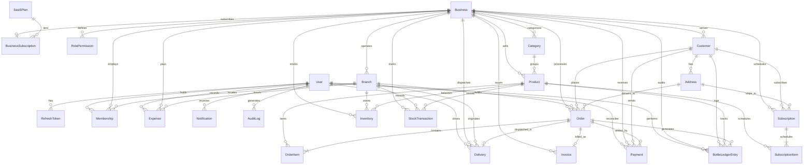

# AquaFlow — Multi-Tenant Water Supply & Distribution Management SaaS

> **Enterprise-grade multi-tenant SaaS platform** engineered for drinking water filtration, bottling, and logistics enterprises delivering 19-liter, 12-liter, and 6-liter water bottles and accessories.

---

## 📑 Table of Contents
1. [Project Overview & Domain Knowledge](#-1-project-overview--domain-knowledge)
2. [System Architecture (Modular Monolith)](#-2-system-architecture-modular-monolith)
3. [Multi-Tenant Architecture & Data Isolation](#-3-multi-tenant-architecture--data-isolation)
4. [Complete Database ERD (Entity Relationship Diagram)](#-4-complete-database-erd)
5. [Core Business Workflows](#-5-core-business-workflows)
   - [A. Order Lifecycle & Status Engine](#a-order-lifecycle--status-engine)
   - [B. Empty Bottle Ledger & Deposit Accounting](#b-empty-bottle-ledger--deposit-accounting)
   - [C. Field Delivery & Cash Reconciliation](#c-field-delivery--cash-reconciliation)
   - [D. Automated Recurring Subscriptions](#d-automated-recurring-subscriptions)
   - [E. Financial Ledger & Profit/Loss](#e-financial-ledger--profitloss)
6. [User Roles & Permission Matrix](#-6-user-roles--permission-matrix)
7. [Technology Stack Matrix](#-7-technology-stack-matrix)
8. [Project Layout & Directory Structure](#-8-project-layout--directory-structure)
9. [AI Agent Governance (`.agents/`)](#-9-ai-agent-governance-agents)

---

## 🌊 1. Project Overview & Domain Knowledge

Filtered drinking water distribution is an operationally intense business with unique physical and financial challenges:

1. **Returnable Physical Capital Assets (Polycarbonate Bottles)**:
   - A 19-liter (5-gallon) bottle is an expensive physical asset that circulates between the factory, delivery vehicle, and customer location.
   - Customers pay a **refundable security deposit** per bottle when first ordering.
   - On subsequent refill orders, customers return empty bottles in exchange for full ones.
   - If a customer holds 5 bottles and only returns 3 on refill delivery, their net outstanding balance becomes 2 bottles. Tracking this without loss or discrepancy requires an **immutable double-entry ledger** (`BottleLedgerEntry`).

2. **Deposit Accounting vs. Operational Sales Revenue**:
   - Customer bottle security deposits are **escrow liabilities**, not operational sales revenue.
   - Mixing deposit cash with product sales distorts profit & loss reports. AquaFlow keeps deposit balances strictly segregated from product sales revenue.

3. **Multi-Stop Route Dispatch & Driver Settlement**:
   - Delivery drivers follow planned daily delivery routes with stops across neighborhoods.
   - At each stop, drivers verify delivery via OTP, collect Cash on Delivery (COD), record empty bottles collected, and note cracked/damaged bottles.
   - At the end of each shift, depot dispatchers reconcile physical cash and collected empty bottles against driver delivery logs.

4. **Recurring Subscriptions (Homes, Offices, Commercial)**:
   - Drinking water is consumed on predictable cadences (e.g. 2 bottles every Monday and Thursday, or 1 bottle daily).
   - AquaFlow automates recurring delivery schedules via **BullMQ idempotent queue workers**, generating delivery orders automatically on scheduled dates.

---

## 🏛️ 2. System Architecture (Modular Monolith)

AquaFlow is architected as a **Modular Monolith** adhering to Clean Architecture principles, ensuring strict separation of concerns, high maintainability, and domain independence:

```text
┌────────────────────────────────────────────────────────────────────────┐
│                        CLIENT PRESENTATION LAYER                       │
│   Super Admin Panel  │ Business Admin Panel │ Delivery Panel │ Customer │
└───────────────────────────────────┬────────────────────────────────────┘
                                    │ HTTP / REST / WebSockets
                                    ▼
┌────────────────────────────────────────────────────────────────────────┐
│                        API GATEWAY & MIDDLEWARE                        │
│   Rate Limiting │ Helmet Security │ Auth (JWT) │ TenantScopeGuard │ Zod │
└───────────────────────────────────┬────────────────────────────────────┘
                                    │
                                    ▼
┌────────────────────────────────────────────────────────────────────────┐
│                     BACKEND DOMAIN MODULES (4-TIER)                    │
│                                                                        │
│   [Auth & Identity]     [SaaS Plans]       [Businesses & Branches]    │
│   [Customers]           [Catalog]          [Orders & Invoicing]        │
│   [Bottle Ledger]       [Inventory]        [Deliveries & Dispatch]     │
│   [Subscriptions]       [Accounting & P&L] [Real-Time Sockets]         │
│                                                                        │
│   Controllers ──► Services (Business Logic) ──► Repositories (Prisma)  │
│   Central Composition Root (src/core/container.ts Dependency Injection)│
└───────────────────┬───────────────────────────────┬────────────────────┘
                    │                               │
                    ▼                               ▼
┌──────────────────────────────────────┐  ┌──────────────────────────────┐
│        PERSISTENCE LAYER             │  │   BACKGROUND & REAL-TIME     │
│   PostgreSQL 16+ (Prisma ORM)        │  │   Redis 7+ & BullMQ Worker   │
│   Shared Database, Shared Schema     │  │   (Idempotent Cron Dispatch) │
│   Row Level Security (RLS)           │  │   Socket.IO (Live Tracking)  │
└──────────────────────────────────────┘  └──────────────────────────────┘
```

---

## 🏢 3. Multi-Tenant Architecture & Data Isolation

AquaFlow uses a **Shared Database and Shared Schema Multi-Tenancy Architecture**:

1. **Tenant Identification**: Every operational model (`Customer`, `Product`, `Order`, `Inventory`, `BottleLedgerEntry`, `Payment`, `Expense`, `Invoice`) carries a `businessId` foreign key.
2. **Context Derivation**: The active `businessId` is derived exclusively from the verified JWT payload and validated business membership.
3. **Repository Enclosure**: Every repository query enforces `where: { businessId, ... }`.
4. **PostgreSQL Row Level Security (RLS)**: Serves as an immutable defense-in-depth barrier.

---

## 🗄️ 4. Complete Database ERD



---

## 🔄 5. Core Business Workflows

### A. Order Lifecycle & Status Engine
```text
Customer / Admin Places Order
             │
             ▼
      [ PENDING ] ──────────────► [ CANCELLED ] (Stock released / not reserved)
             │
             ▼
     [ CONFIRMED ] ─────────────► Price frozen into OrderItem snapshot
             │                    Invoice generated (INV-XXXX)
             ▼
    [ PROCESSING ] ─────────────► Depot prepares water bottles
             │
             ▼
      [ ASSIGNED ] ─────────────► Assigned to Delivery Driver & vehicle
             │                    Delivery record generated with OTP code
             ▼
  [ OUT_FOR_DELIVERY ] ─────────► Driver starts daily delivery route
             │                    Customer notified via Socket.IO
             ▼
      [ DELIVERED ] ────────────► OTP verified
             │                    Empty bottles returned recorded
             │                    Cash collected logged
             │                    BottleLedgerEntry appended
             │                    Branch inventory adjusted
             ▼
         [ FAILED ] ────────────► Re-scheduled or marked failed with reason
```

---

### B. Empty Bottle Ledger & Deposit Accounting (Double-Entry Mechanics)

Every movement of bottles creates an **immutable append-only** `BottleLedgerEntry`:

```text
Customer Order: 5 x 19L Full Bottles Delivered
Customer Returns: 3 x 19L Empty Bottles
Customer Returns: 0 x Damaged Bottles

Ledger Entry:
├── fullDelivered: +5
├── emptyReturned: +3
├── damagedCount: 0
├── netChange: +2 bottles
└── runningBottleBalance: Previous Balance + 2

Held Deposit Calculation:
├── If New Bottles Issued: depositAmount added to Escrow Liability
└── If Empty Bottles Returned for Refund: refundAmount deducted from Escrow
```

$$\text{Customer Outstanding Bottles} = \sum \text{Full Delivered} - \sum \text{Empty Returned} - \sum \text{Damaged}$$
$$\text{Customer Deposit Balance} = \sum \text{Deposit Paid} - \sum \text{Deposit Refunded}$$

---

### C. Field Delivery & Cash Reconciliation

```text
1. Driver starts route ──► Status: OUT_FOR_DELIVERY
2. Driver reaches customer:
   ├── Hands over full bottles
   ├── Collects empty return bottles
   ├── Collects Cash on Delivery (COD)
   └── Validates customer OTP
3. Driver taps "Complete Delivery":
   ├── Delivery status: DELIVERED
   ├── Payment status: COLLECTED_BY_DRIVER
   └── BottleLedgerEntry created automatically
4. Evening Shift Settlement (Depot Office):
   ├── Driver hands cash and physical empty bottles to Cashier/Accountant
   └── Accountant clicks "Reconcile Settlement": Payment status -> RECONCILED
```

---

### D. Automated Recurring Subscriptions

```text
BullMQ Daily Scheduler (Runs 00:30 AM Daily)
             │
             ▼
Fetch ACTIVE subscriptions where nextDeliveryDate == Today
             │
             ▼
Generate deterministic Job ID: sub-dispatch-{subscriptionId}-{yyyy-MM-dd}
             │
             ▼
Create Order record (Status: CONFIRMED)
Advance subscription nextDeliveryDate
Emit Socket.IO alert to Depot Dispatcher
```

---

### E. Financial Ledger & Profit/Loss

- **Operating Revenue**: Water refills sold + Delivery fees + Non-returnable merchandise sold.
- **Deposit Liabilities (Escrow)**: Kept separate on balance sheet liabilities.
- **Cost of Goods Sold (COGS)**: Raw water supply cost + purification filter replacements + bottle caps.
- **Operating Expenses**: Fuel, vehicle maintenance, plant electricity, employee wages.
- **Net Profit**: $\text{Operating Revenue} - \text{COGS} - \text{Operating Expenses}$.

---

## 👥 6. User Roles & Permission Matrix

| Role | Default Access Scope | Key Capabilities |
| :--- | :--- | :--- |
| **Super Admin** | Platform-Wide | All businesses, SaaS plans, global MRR, audit logs |
| **Business Owner** | Entire Business Workspace | Settings, branches, staff, catalog, finances, reports |
| **Manager** | Business Operations | Dispatch, order approvals, inventory intake, drivers |
| **Accountant** | Financial Records | COD cash reconciliation, expense records, P&L statements |
| **Delivery Staff** | Assigned Deliveries | Route stops, OTP verification, bottle/cash collection |
| **Customer** | Own Account & Orders | Catalog, one-time orders, recurring subscriptions |

---

## 🛠️ 7. Technology Stack Matrix

| Layer | Technology | Purpose & Rationale |
| :--- | :--- | :--- |
| **Backend Runtime** | Node.js 20+ LTS / TypeScript 5.x | High-throughput asynchronous I/O with strict type safety |
| **HTTP Framework** | Express.js 4.x / 5.x | Battle-tested REST API architecture mounted at `/api/v1` |
| **Database & ORM** | PostgreSQL 16+ with Prisma ORM | Relational integrity, foreign keys, compound indexes, RLS |
| **Queue & Caching** | Redis 7+ & BullMQ | Deterministic, idempotent recurring subscription dispatch |
| **Real-Time Sockets** | Socket.IO | Live delivery status updates and dispatch notifications |
| **Validation** | Zod 3.x | Runtime payload validation for request body, query, and params |
| **Frontend Framework**| React.js 18+ & Vite & TypeScript | Lightning-fast build times, modular component hierarchy |
| **Styling & Components**| Tailwind CSS & shadcn/ui | Modern, clean white and light-blue SaaS theme |
| **State Management** | Redux Toolkit & TanStack Query | Client session state + automated server-state caching |
| **Analytics Visuals** | Recharts | Interactive revenue, bottle return, and delivery charts |

---

## 📂 8. Project Layout & Directory Structure

```text
AquaFlow/
├── .agents/                    # AI Agent Governance & Knowledge Base
│   ├── rules/                  # Senior Engineering Rules (00 to 10)
│   ├── skills/                 # Procedural Playbooks (build-feature, postgresql, etc.)
│   ├── context/                # Master Domain Context & Specifications
│   │   ├── modules/            # 14 Detailed Domain Specification Documents
│   │   ├── PROJECT_CONTEXT.md  # Master Architecture & Entities Blueprint
│   │   ├── KNOWN_FOOTGUNS.md   # Architectural & Operational Traps Catalog
│   │   ├── PROMPTS.md          # Engineering Prompts
│   │   └── FEATURE_LOG.md      # Milestone & Feature Progress Audit Log
│   └── AGENTS.md               # Agent Operating Blueprint Mirror
├── backend/                    # Node.js + Express + Prisma Modular Monolith
│   ├── prisma/
│   │   └── schema.prisma       # 24 Normalized PostgreSQL Models
│   ├── src/
│   │   ├── config/             # DB, Redis, Environment configurations
│   │   ├── core/               # Composition root (container.ts), base contracts
│   │   ├── middlewares/        # Auth, Tenant Scoping, Validation, Errors
│   │   ├── modules/            # Domain Modules (Auth, Orders, Bottle Ledger, etc.)
│   │   ├── jobs/               # BullMQ Queues and Workers
│   │   ├── sockets/            # Socket.IO Event Handlers
│   │   └── utils/              # AppError, ApiResponse, Math helpers
│   ├── package.json
│   ├── tsconfig.json
│   └── README.md
├── frontend/                   # React + TypeScript + Vite + Tailwind CSS
│   ├── src/
│   │   ├── app/                # Redux Store, Query Client, App Router
│   │   ├── components/         # shadcn/ui Shared UI Primitives
│   │   ├── layouts/            # 4 Layouts: SuperAdmin, Business, Delivery, Customer
│   │   ├── features/           # Domain Feature Slices
│   │   ├── hooks/              # Custom React Hooks
│   │   ├── services/           # Axios/Fetch API Clients
│   │   └── utils/              # Formatters & Helpers
│   └── README.md
├── AGENTS.md                   # Root Agent Instructions
├── README.md                   # Project Master Blueprint (This Document)
├── ROADMAP.md                  # High-Level Architecture & Phase Milestones
└── feature.md                  # Granular Step-by-Step Implementation Tracker
```

---

## 🤖 9. AI Agent Governance (`.agents/`)

The workspace is governed by a persistent AI Context Engine modeled after enterprise engineering standards:
- **`rules/`**: 11 operating rules enforcing Clean Architecture, strict multi-tenancy, data integrity, and closed-loop verification.
- **`skills/`**: Procedural playbooks (`build-feature`, `postgresql-prisma-best-practices`, `multi-tenant-isolation`, `systematic-debug`, `refactor-module`).
- **`context/`**: Master memory with 14 domain module specs and known footguns to prevent context drift across development turns.
- **`feature.md`**: Step-by-step progress tracking where every completed capability is verified and logged.

